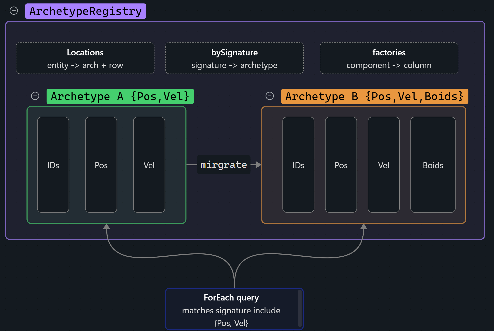

# ECS Archetype Framework Documentation (C++ / raylib)

## Overview

This Entity Component System logic is separated into three parts:

- **Entities** — IDs only (no behaviour/data by themselves)
- **Components** — plain data structs (`Transform2D`, `Control`, `Sprite`, etc.)
- **Systems** — logic that processes entities matching a component signature

## Table of Contents

- [Changes in this version](#changes-in-this-version)
- [Core Concepts](#core-concepts)
  - [Entity](#entity)
  - [Component](#component)
  - [Signature (Archetype Mask)](#signature-archetype-mask)
  - [Constants and Limits](#constants-and-limits)
- [Architecture](#architecture)
- [1. ComponentColumn](#1-componentcolumn)
- [2. Archetype](#2-Archetype)
- [3. ArchetypeRegistry](#3-archetyperegistry)
- [4. Systems](#4-Systems)

## Core Concepts

### Entity

An Entity is just an integer ID:

```cpp
using EntityID = std::uint32_t;
```

Entities do not store data directly. Their data lives in component columns.

### Component

A component is a plain data struct that describes one aspect of an entity. Each is registered once via `RegisterComponent<T>()` before use. The built-in components are:

`Position` / `Velocity` — 2D kinematics, used by the boids sim.
```cpp
struct Position { float x, y; }; 
struct Velocity { float x, y; };
```

`Boids` — per-boid steering scratch: the force accumulated this frame (written by the steer pass, applied and reset by the integrate pass).
```cpp
struct Boids { float ax = 0, ay = 0; };
```

`Transform2D` — a combined kinematics component (position + velocity in one struct),
for entities that don't split the two.

```cpp
struct Transform2D {
	Vector2 position = { 0, 0};
	Vector2 velocity = { 0, 0};
};
```

`Control` — which player controls an entity.

```cpp
struct Control {
    int controlledBy;
};
```

`Interactable` — selection state (e.g. RTS unit picking).

```cpp
struct Interactable {
    bool selected = false;
};
```

`Sprite` — a raylib texture pointer for drawing.

```cpp
struct Sprite {
    Texture* texture = nullptr;
};
```
>Game-specific components live in their own headers and are registered the same way — `RegisterComponent<T>()` accepts any type.

### Signature (Archetype Mask)

A Signature is a bitset representing which components an entity has.

```cpp
using Signature = std::bitset<MAX_COMPONENTS>;
```

Each bit corresponds to a component type ID (assigned in registration order by `GetComponentID<T>()`). An entity's signature is the exact set of components it has, and it uniquely identifies the [Archetype](#2-Archetype) the entity lives in. Queries build a required signature from their component pack and match every archetype whose signature contains those bits — so the signature is both the archetype's identity and the query's filter.
### Constants and Limits

```cpp
using EntityID       = std::uint32_t;
const EntityID MAX_ENTITIES = 20'000;
constexpr size_t MAX_COMPONENTS = 64;
```

**What these mean**

- `MAX_ENTITIES`: max number of active entities at once. 
- `MAX_COMPONENTS`: max number of unique component types. `std::bitset<MAX_COMPONENTS>` is fixed at compile time, so raising this is a one-line change plus a recompile — not a runtime resize. 64 is one 64-bit word; larger values still keep the signature small and cheap to AND/compare.

>[!note] `MAX_ENTITIES` is carried over from the sparse-set engine and is not a hard cap here — archetype columns are `std::vector`s that grow as needed. It currently bounds nothing in the archetype path; treat it as advisory until removed. 

## Architecture



---
## 1. ComponentColumn

**Responsibility**

Stores the data for one component type `T`, for every entity in a **single archetype**, in a contiguous `std::vector<T>`. This is the key difference from a sparse-set ECS: there is one column per component per archetype, not one global array per component. Row `r` of every column in an archetype, plus `entityIDs[r]`, all described the same entity — the parallel-packed invariant that makes iteration a pure linear stream.

`IComponentColumn` is the type-erased base so an archetype can hold columns of mixed `T` behind the `unique_ptr<IComponentColumn>`;`ComponentColumn<T>` is the concrete storage.

**Main Methods**
- `MoveTo(row, dest)` — moves the element at `row` into another column of the same `T` (via `push_back`). Used during migration to carry a component from the source archetype's column into the destination's.
- `SwapRemove(row)` — removes the element at `row` by moving the last element into the hole and popping, keeping the vector dense. Guards against self-move when `row` is already last.
- `CloneEmpty()` — returns a new empty column of the same concrete type. Lets the registry build a new archetype's column from a bare signature without knowing the concrete `T` at that point.
- `Size()` — element count (used for consistency checks).
---
## 2. Archetype

**Responsibility**

Holds all entities that share one **exact** component set. An archetype owns: its `signature`, a dense `entityIDs` list, one [ComponentColumn](#1-componentcolumn) per component in the signature, and a `compToCol` map from component ID to column index (since signature bits aren't densely packed). Everything at index `r` — `entityIDs[r]` and every `columns[...]`'s element `r` — belongs to the same entity.

Because entities are grouped by exact set, a query over several component resolves to "visit the archetype whose signature contains those bits, and stream their columns" — the columns are already parallel and contiguous, so multi-component iteration needs no per-entity lookup. The trade is that changing an entity's component set moves it to different archetype (see [ArchetypeRegistry](#3-archetyperegistry) migration).

**Main Methods**
- `Col(compID)` — returns the type-erased column for a component ID (asserts the archetype has it).
- `TypedCol<T>()` — returns `ComponentColumn<T>*` for directly typed access to a column's data.

---

## 3. ArchetypeRegistry

**Responsibility** 

The main entry point. Owns all archetypes, maps each entity to its current archetype + row (`locations`), and provides create/add/remove/query. It also holds per-component **factories** (registered by `RegisterComponent<T>()`) so it can build a new archetype's columns from a bare signature — turning a set of bits back into correctly-typed columns without knowing `T` at the call site.

Archetypes are keyed by signature in an `unordered_map` (`std::bitset` has a `std::hash`), so finding-or-creating an archetype is O(1), not a linear scan.

**Main Methods**
- `RegisterComponent<T>()` — assigns `T` a component ID and records its column factory. Call once per component type before use.
- `CreateEntity()` — returns a new ID. The entity starts in the empty (zero-signature) archetype until it gains a component.
- `AddComponent<T>(e, vlaue)` / `RemoveComponent<T>(e)` — **structural changes:** they migrate the entity's row between archetypes (see below).
- `DestroyEntity(e)` — swap-removes the entity's row from its archetype and drops its location.
- `GetComponent<T>(e)` — reference to one entity's component (random access: hash `locations`, then index the column).
- `Has(e)` — whether the entity exists.
- `ForEach<Comps...>(fn)` — the primary iteration path. Builds the required signature, visits every archetype containing those components, and calls `fn(EntityID, Comps&...)` per row with the columns streamed in lockstep. Empty archetypes are skipped.
- `ArchetypeCount()` / `GetArchetypes()` — introspection.

**Migration model (how Add/Remove work)**

Changing an entity's component set changes its signature, so it must move to a different archetype. `AddComponent` / `RemoveComponent`:
1. Find the entity's current archetype and row.
2. Compute the new signature and get-or-create the destination archetype.
3. `MoveTo` each carried component from the source columns into the destination's matching columns; append the new component (add) or skip the removed one (remove).
4. Swap-remove the vacated row from the source archetype — and fix up the row index of whichever entity got swapped into the hole. This bookkeeping is what keeps `locations` correct; omitting it desyncs reads.
5. Update the entity's location to the destination.
This is why structural changes is the expensive operation in an archetype ECS (it copies the entity's data between chunks), the mirror image of a sparse-set ECS where add/remove is cheap and multi-component iterations is the costly side.

## 4. Systems

**Responsibility**

Logic that processes entities matching a component signature. The simplicity way of implementing a system is to use the `ForeEach<Comps...>(fn)` method:
```cpp
ecs_.ForEach<ECS::Position, Rotation, Collider, CollisionState>(
  [](ECS::EntityID, ECS::Position& p, Rotation& r, Collider& collider, CollisionState& state) {
		const Color color = state.sensor ? YELLOW : (state.hit ? ORANGE : BLUE);
		if (collider.GetShape() == Collider::Shape::Circle) {
  		DrawCircleV({p.x, p.y}, collider.GetCircleRadius(), color);
		} else {
  		const auto h = collider.GetBoxHalfExtents();
  		DrawRectanglePro({p.x, p.y, h.x*2, h.y*2}, h, r.radians*RAD2DEG, color);
		}
});
```

>[!note] Iterations + structural change don't mix. `AddComponent`, `RemoveComponent`, and `DestroyEntity` can reallocate archetype storage and swap-remove rows, invalidating an in-flight `ForEach`. Don't call them from inside a `ForEach` — record the intent and apply it after the loop (a deferred command buffer is the usual pattern).

Notes:
- Every entity is born into the empty (zero-signature) archetype, which persists even after all entities migrate out of it — so `ArchetypeCount()` is (distinct populated component sets) + 1. Adding components one at a time can also create intermediate archetypes an entity only passes through.
